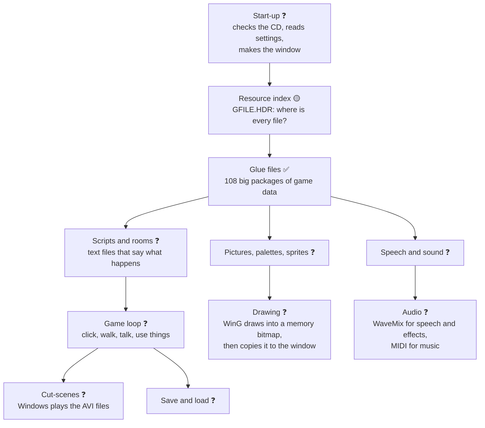

# How the parts of Dark Seed II fit together

A plain-language map of what the game's program does and how its parts talk to each other.
It grows as we recover more of the original. It is written for people, not for the debugger:
no addresses and no jargon. The exact details live in `STRUCTS.md` and `contracts/`.

**How much do we trust each part?**
- ✅ Read in the program, checked against the real game files
- 🟡 Read in the program, but something named in the heading is not checked yet
- ❓ Seen from the outside only (the strings and the Windows calls it uses), not read yet

**Rule:** a function can only be marked done when its contract is complete and this file explains it.
`tools/mark.py` refuses otherwise, and `CHECKLIST.md` only ticks documented functions.

Last updated: 6 November 2026. Counts: see the table at the top of `CHECKLIST.md`.

## The game in one paragraph

Dark Seed II is a Windows 3.1 program, 184 KB, plus a large pile of data files. The program is small:
it knows how to open the data files, draw pictures on a Windows window, play sound and video by
asking Windows to do it, and run the game's own text scripts. Almost everything about the story, the
rooms and the conversations lives in the data files as plain text. That is why reimplementing the game
is mostly about reading the data correctly and running its scripts faithfully.

## The big picture

## Resources: the index and the glue files 🟡

**What it does.** The game's data is stored in 108 large "glue" files (`gl00_*.000`), a bit like zip
files without the zip. A small separate file, `GFILE.HDR`, is the phone book: for each of the 9291
resources (pictures, scripts, speech clips, text) it says which glue file holds it, how big it is
and where it starts.

**How it works.**
1. At start-up the game reads `GFILE.HDR` once. It keeps the list of glue file names and the full
   list of 9291 entries in memory. The list is sorted by name, so finding a resource is a quick search.
2. Each glue file starts with its own small table of contents (a copy of the phone-book lines for its
   files) followed by the data.
3. Most glue files (85 of 108) are **squeezed**. Squeezed files are split into 2 KB blocks. Each block
   is a series of short packets: either "copy these two bytes" or "repeat something that appeared a
   little earlier". The game unsqueezes a whole glue file into memory when a room needs it.
   The remaining 23 files (the always-needed ones and the big speech files) are stored plainly and
   read straight from disk when needed.
4. A request for a resource looks it up in the phone book, then either copies it out of the unsqueezed
   memory copy or reads it from the file.

**Checked against the real files.** The phone book, the table of contents inside each glue file and
the unsqueezing were checked against all 108 files: every resource lands on valid data (for example,
every picture starts with the picture marker). ✅ for the layout and the unsqueezing.
🟡 because we have not yet read how the game decides which files to unsqueeze when, how it looks a
name up in the list, or how it reads the plain files; the code for those is only partly read.

**Our copy is Spanish.** The text and speech in these files are Spanish.

**For the ScummVM engine.** The 2011 engine unsqueezes the same way, which matches. It builds its
own index from the glue tables instead of reading `GFILE.HDR`; the result is the same, but the original
way is faster to start.

## Memory 🟡

**What it does.** The game asks Windows for blocks of memory through two tiny helpers: one to get a
block of a given size, one to give it back. It keeps count of how many blocks it has taken and given
back. If Windows cannot give memory, the game shows an error and stops.

**For ScummVM.** This becomes ordinary allocation; no behaviour to copy except the error on failure.
Marked 🟡 only because the exact error and exit path has not been read.

## Windows services the game relies on ❓

Seen from the list of Windows calls the game makes. None of this is read yet.

| Job | What the game uses | What ScummVM replaces it with |
|---|---|---|
| Window, mouse, keyboard, timers | Windows window procedures and timers | ScummVM's event loop |
| Drawing | WinG (a Windows 3.1 fast-drawing add-on) and palette calls | ScummVM graphics surface and palette |
| Video | The Windows media player (MCI) opens each `.avi` and plays it in a rectangle | ScummVM's AVI decoder |
| Music | The Windows MIDI sequencer, playing `.mid` files from `sndtrack` | ScummVM's MIDI driver |
| Speech and effects | WaveMix (a mixing library): open a wave, play it on a channel | ScummVM's mixer |
| Options and saves | Windows `.INI` files and dialog boxes | ScummVM options and save screens |
| Files and memory | Windows file and memory calls | ScummVM streams and plain allocation |

## Scripts, rooms and conversations ❓

The program's text strings show what the game's scripts look like. Nothing is read yet, but it tells
us the vocabulary.

- **Room files** (`ROOMnnnn.DAT`) have sections for the backdrop, the walkable area, the scale of
  characters, sprites, music, mirrors, palettes, and what happens when you look at, use or walk to
  things.
- **Actions** inside them include changing something, waiting for a condition, playing an effect,
  speaking a line, starting a dialogue, changing the cursor or palette, and destroying an object.
- **Conversation files** have speakers, messages, entries the player can choose, conditions,
  assignments and "fall through" links between entries.
- **Game variables** are kept in a sorted list from `GameVar.IDX`. Some have fixed names the program
  itself uses, such as the last action, where Mike came from, whether Mike is shown, and whether a
  cut-scene is running.

## What is not covered yet

Almost everything in the program. The next clusters to read, in order: the rest of the resource layer,
then the pictures and palette, then the script interpreter (see `clusters.md`).
